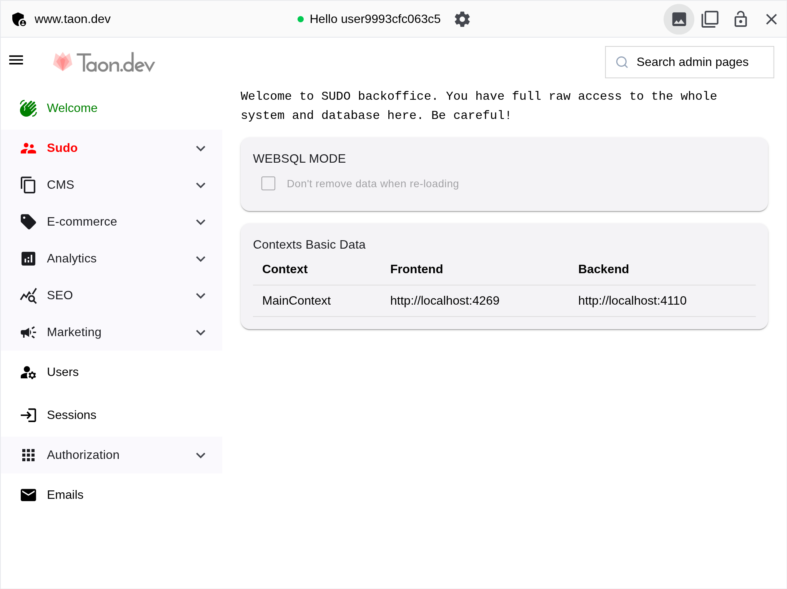
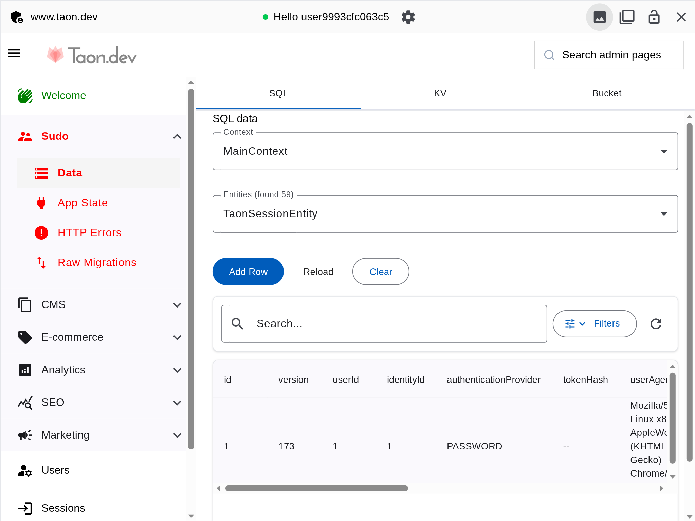
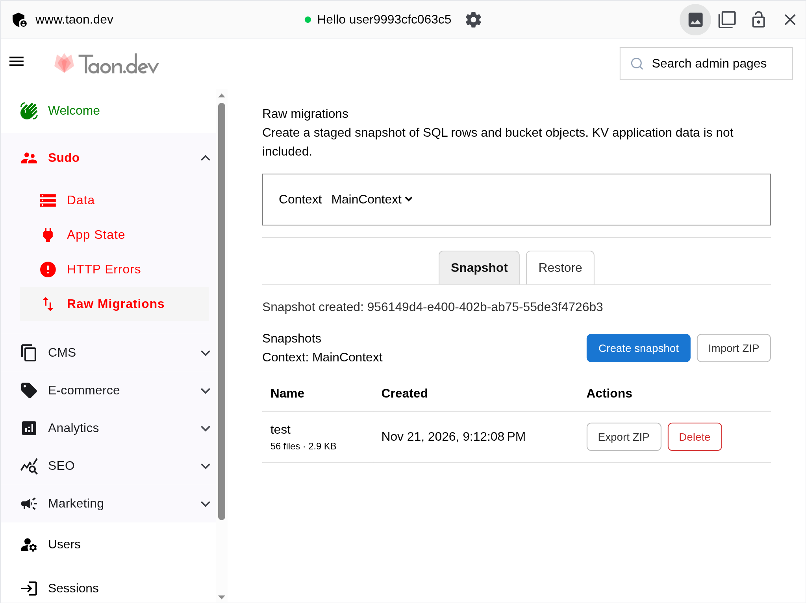
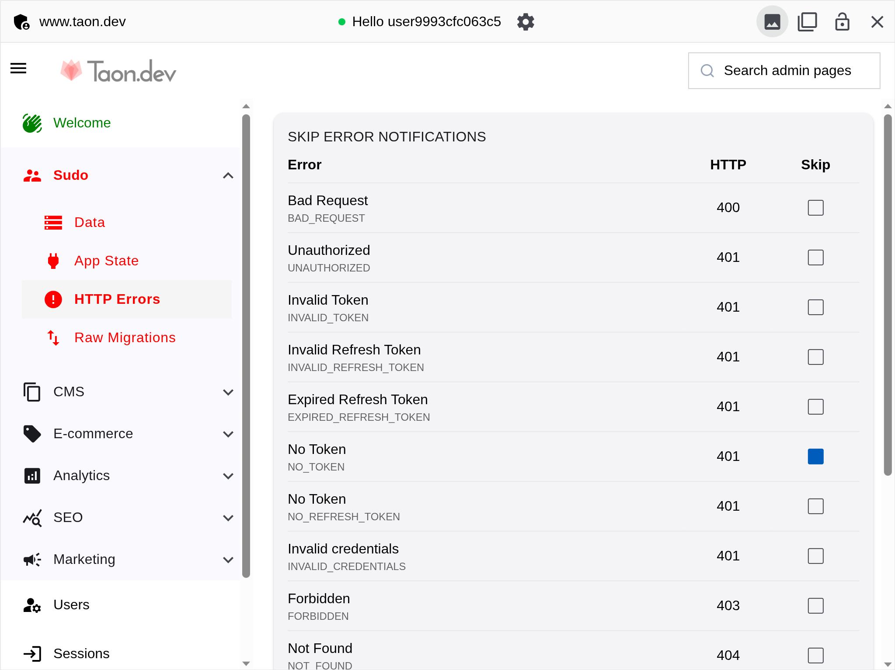

# Sudo

Sudo gives you access to Taon Admin’s tools for managing application data, restoring snapshots, and troubleshooting HTTP errors. To use these tools, Sudo must be enabled for your account’s email address.

## Data

The Data tab works like phpMyAdmin. You can browse SQL tables and edit or delete records directly from Taon Admin.

## Raw Migrations

Use the Raw Migrations tab to create, export, import, and restore snapshots of your application data. You can use snapshots to back up data or move it between environments.

Every restore opens the Raw Migration Restore Editor. It analyzes the snapshot
against the current SQL schema, lets you map renamed tables and columns, and
requires you to choose the SQL tables and bucket controllers that may be
modified. The preview validates required columns, primary keys, types, and
schema fingerprints before execution. Mapping presets can be imported or
downloaded as JSON for reuse. Tables and buckets excluded from the plan are not
cleared or restored.

## App State

**Work in progress**

The App State tab is designed to control when users can interact with your application and when it accepts API requests. Planned features include:

- Schedule a maintenance window that blocks new database transactions for a set duration, such as 20 minutes.
- Block incoming user requests and redirect users to a maintenance page.
- Automatically lock the application after a manual deployment rollback so you can reverse the affected transactions before unlocking it.

## HTTP Errors

Use the HTTP Errors tab to mute HTTP errors, which can be useful when testing your application locally.

## SQL Scripts

**Work in progress**

The SQL Scripts tab will let you save reusable SQL snippets and run them against your application database.
